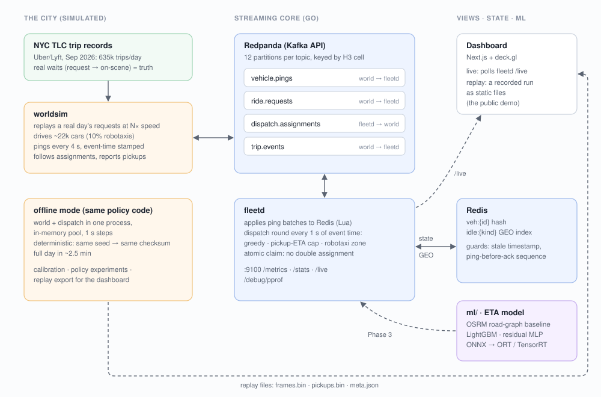
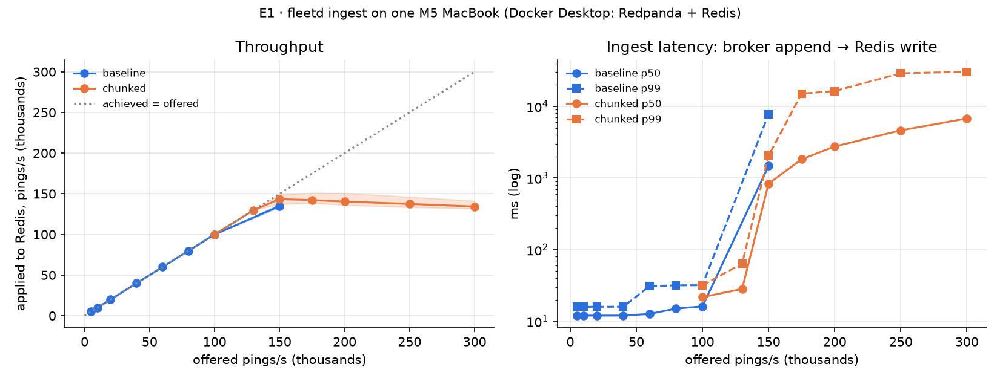
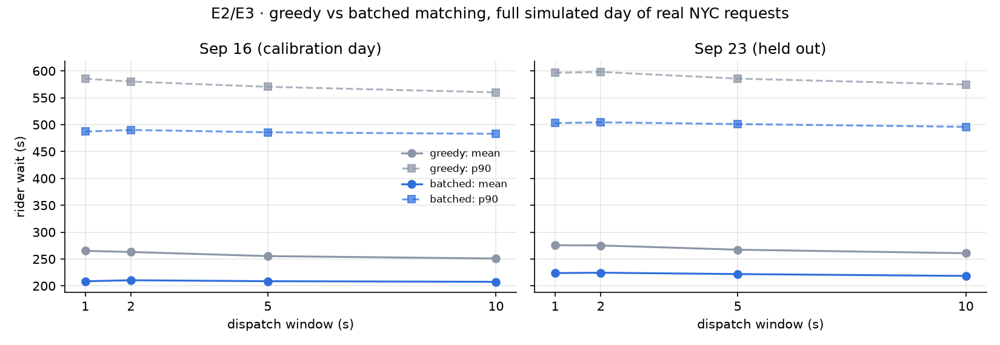
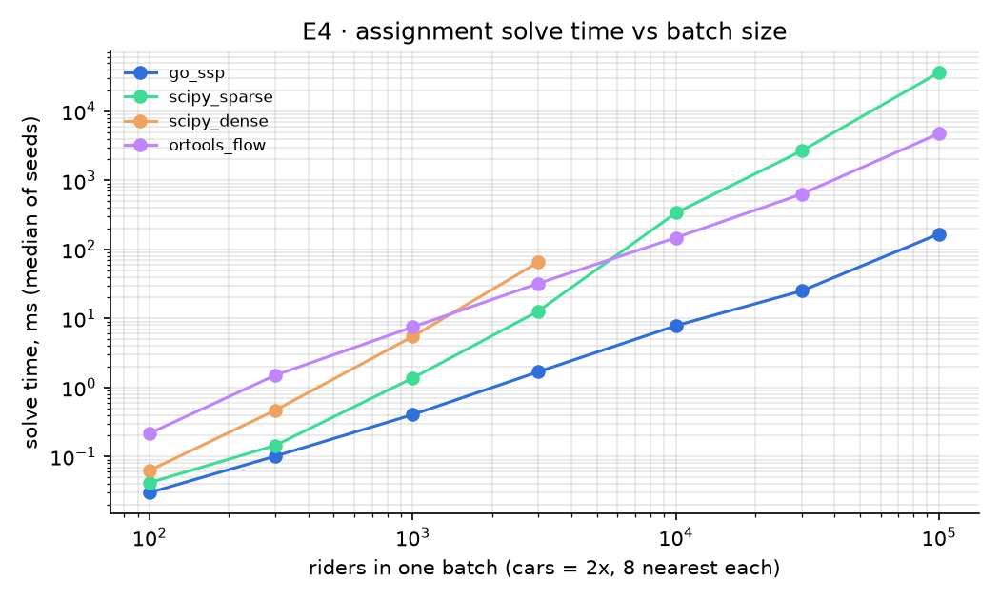

# Fleetline

**Real-time ride dispatch for a mixed fleet of human drivers and robotaxis, replaying a real day of NYC Uber/Lyft demand.** Go streaming core on Kafka (Redpanda) + Redis, a deterministic simulator calibrated against real wait times, an ML arrival-time model, and a live map.

**▶ Live demo: [fleetline-sigma.vercel.app](https://fleetline-sigma.vercel.app)**: 29,087 vehicles serving 12,917 real ride requests, 08:00–08:20 on Wed Sep 16, 2026. **[Compare view](https://fleetline-sigma.vercel.app/?mode=compare)**: greedy and batched matching side by side on the same morning (mean wait 4:43 → 3:23 in that window).



Every number below was produced by a script in this repo. Each links to its result file.

## Results

### Streaming ingest (E1): how many vehicle pings/s one laptop sustains
One M5 MacBook Pro, Docker Desktop (Redpanda + Redis), open-loop load generator, 3+ runs per rate.

| Version | Sustained (runs) | Peak applied | p99 at 150k | What changed |
| --- | --- | --- | --- | --- |
| Baseline | 130k pings/s (3/3) | ~135k/s | (fails) | one Redis Lua call per ping, batches applied one at a time |
| + chunked Lua ("inline") | 130k (3/3), 150k (2/3) | 153k/s | 242 ms | one Lua call per 256 pings: latency halves at 130k |
| **+ concurrent apply (4 workers)** | **150k (3/3), 175k (2/3)** | **187.6k/s (+22%)** | **46 ms** | decode the next batch while Redis writes this one |

The last two rows are an interleaved A/B (inline, workers, inline, workers…, 3 pairs, with cool-downs) so machine drift hits both equally.

"Sustained" = fleetd applies ≥ 99% of what's offered with < 0.1 s of backlog at the end of a 30 s step. Ingest latency = broker append → state written in Redis (worst ping per batch). Profiles showed Redis's single core as the limit, then fleetd's serial loop leaving Redis idle. → [`bench/e1/`](bench/e1/), learning note [07](docs/learning/07-load-testing.md)



**Backpressure:** at 50k pings/s, freezing Redis for 10 s builds a 511k-ping backlog in Kafka that drains in ~8 s; stopping Redis for 5 s triggers retries. Both runs end with **applied = sent exactly (0 lost)**. The test found and fixed a bug where Redis errors silently dropped batches. → [`backpressure.png`](bench/e1/backpressure.png)

### Batched matching vs greedy (E2/E3): a full held-out day
Greedy gives each rider the nearest free car immediately; batched solves all waiting riders together as an exact min-cost assignment (own sparse solver, checked against brute force). Same simulator, day, supply and candidate search; only the matching step changes. Tuned on Sep 16, reported on **Sep 23 (603,327 real requests), 3 seeds**:

| Policy | Mean wait | Median | p90 | Empty drive to pickup | Unserved |
| --- | --- | --- | --- | --- | --- |
| Greedy | 274 s | 215 s | 597 s | 243 s | 0.07% |
| **Batched** | **223 s (−18.6%)** | **175 s (−18.4%)** | **503 s (−15.7%)** | **195 s (−19.5%)** | 0.10% |

Seed spread ±2 s. Pure total-time minimization starved far-away, long-waiting riders (unserved ×2.7); an age weight fixed it at a small cost. The dispatch window (1–10 s) barely moves batched; greedy improves with longer windows, narrowing the gap to −16%. → [`bench/e2/`](bench/e2/RESULTS.md), learning note [09](docs/learning/09-batched-matching.md)



**Stress test (E2b):** with a fitted driver-decline model (10 s to answer; far pickups declined more; 24–27% of offers declined), batched still cuts mean wait **16.9%** on held-out Sep 23. The model did *not* make hourly waits match reality better on the held-out day, so it stays a stress test ([D-017](docs/DECISIONS.md), [`bench/offers`](bench/offers/RESULTS.md)).

### Solver speed (E4): exact assignment at city scale
Instances from real NYC pickup/drop-off points (8 nearest cars per rider); every solver must reach the same optimal total.

| Riders per batch | Fleetline Go solver | OR-Tools min-cost flow | SciPy sparse LAPJV |
| --- | --- | --- | --- |
| 1,000 | **0.40 ms** | 7.5 ms | 1.4 ms |
| 100,000 | **168 ms** | 4.76 s (28×) | 36.4 s (217×) |

Geography keeps augmenting paths short, so the Go solver scales ~n^1.1. → [`matcher/`](matcher/README.md)

**GPU (RTX 5060, same-machine comparison):** a custom CUDA auction solver, exact and verified against Go on every run, **never beats the Go solver**. At 100k riders it takes 1.18 s vs Go's 649 ms on that laptop, while beating OR-Tools (18.0 s) by 15× and SciPy (50.5 s) by 43×. Below 30k riders it loses to every CPU solver (1k: 250 ms vs 1.6 ms). Nsight shows why: the work is chains of evictions handled a few bids per round, so ~1 of 26 SMs is busy ([learning note 10](docs/learning/10-gpu-auction.md)). Dashed lines in the plot are the RTX 5060 machine.



### Delivery routes (E7): does the optimizer drive like real Amazon drivers?
3,052 held-out real routes from the [Amazon Last Mile Routing Challenge](https://registry.opendata.aws/amazon-last-mile-challenges/), scored with the challenge's official scorer (0 = the driver's exact stop order).

| Method (OR-Tools, 1 s per route) | Score (lower = closer) | Tour time vs driver |
| --- | --- | --- |
| Shortest tour | 0.0877 | 0.904 |
| Shortest tour + penalty for leaving a zone | **0.0547 (−37.6%)**, better on 86% of routes | 0.940 |

The penalty was tuned on 200 training routes and the held-out set was run once. A variant that guessed zone adjacency from zone ids lost. → [`routing/`](routing/README.md), [notes](docs/learning/11-last-mile-routing.md)

### Simulator validity
| Check | Result |
| --- | --- |
| Determinism | same seed → byte-identical `trips.csv` (SHA-1) |
| Calibration day (Sep 16) | median wait **206 s vs real 212 s**, p90 **586 vs 550 s**, 0.10% unserved |
| Speed | a full day (620k requests, ~22k cars, 1 s steps) in **2m37s** offline |
| Held-out day (calibrated on Sep 16, tested on Sep 23) | median wait **217 s vs real 208 s**, p90 **597 vs 546 s** |
| Pickup-ETA cap (stops the "wild goose chase") | p90 wait **1,370 s → 790 s** on the same day |
| Known gap | per hour only 10/18 hours within ±15%: real waits include driver accept/decline time we don't model yet ([D-015](docs/DECISIONS.md)) |

### ETA model (E5/E6), 4.1M held-out trips
| Model | Mean abs. error |
| --- | --- |
| OSRM road-graph time (no traffic) | 515.7 s |
| × hour-of-week traffic factor | 314.4 s |
| **LightGBM** | **236.5 s** (−54% vs OSRM) |
| Residual MLP (PyTorch, DeepETA-style) | 266.1 s: loses to LightGBM; wider/longer training didn't help |

ONNX export matches PyTorch exactly (same test MAE); ONNX Runtime CPU 0.009 ms at batch 1, M5 GPU 2× faster than CPU at batch 8,192. On an RTX 5060, TensorRT FP16 keeps the same test MAE (+0.003 s) and is 2.3–8.9× faster than PyTorch on the same GPU (0.38 ms at batch 8,192). → [`ml/`](ml/)

### Bugs the benchmarks caught
- **A "6× better than Uber" demo** that was a warm-up artifact (fleet still idle at 08:00).
- **A 0.01 s median wait**: a data leak (cars spawned where future riders would appear).
- **An optimization that changed answers**: a full-day A/B with the optimization off found riders wrongly skipped; a 2-hour test had passed.
- **A benchmark that drifted**: after 25 min of saturation every Redis op cost 2×. Runs are now interleaved A/B with cool-downs.

## How it works

- **The city** (`core/internal/world`, `cmd/worldsim`): replays each real request at its real time and place, drives cars along road-distance-calibrated legs, sends a GPS ping every 4 s. ~10% of the fleet are robotaxis that only serve trips inside a Manhattan geofence.
- **The system** (`cmd/fleetd`): consumes pings and requests from Kafka (partitioned by H3 cell), keeps vehicle state in Redis with Lua guards against out-of-order pings and double assignment, and runs a dispatch round every second of event time.
- **Offline mode** (`cmd/offline`): the same dispatch code in one deterministic process, for calibration and policy experiments without laptop timing noise.
- **Dashboard** (`web/`): replay mode (static files, the public demo) and live mode (polls fleetd).

## Run it

```bash
# data: Sep 2026 Uber/Lyft trips (~510 MB) -> one replay day + travel model
cd sim && uv run fleetline-sim download && uv run fleetline-sim prepare && uv run fleetline-sim calibrate && cd ..

make demo                      # Redpanda + Redis + fleetd + worldsim, live; stats at localhost:9100/stats
cd web && npm i && npm run dev # dashboard at localhost:3000 (Live tab shows the running demo)

make test                      # Go + Python unit tests (CI also runs Kafka/Redis integration tests)
bench/e1/ab.sh 3               # E1 load test, interleaved A/B
```

Requires Go, Docker, [uv](https://docs.astral.sh/uv/), Node.

## Repo

| Path | |
| --- | --- |
| `core/` | Go: world, dispatch, state (Redis + in-memory), offline simulator, fleetd, worldsim, load generator |
| `sim/` | Python: data download, cleaning, travel-model calibration |
| `ml/` | ETA model: OSRM, LightGBM, PyTorch, ONNX, TensorRT |
| `routing/` | Python: E7 last-mile stop sequencing (OR-Tools) on Amazon routes |
| `bench/` | Every experiment's script and results |
| `web/` | Next.js + deck.gl dashboard |
| `docs/` | [Scope](docs/PROJECT_SCOPE.md) · [Decisions](docs/DECISIONS.md) · [Progress](docs/PROGRESS.md) · [Phase 1 checklist](docs/PHASE1_CHECKLIST.md) · [Learning notes](docs/learning/) |

Data: [NYC TLC trip records](https://www.nyc.gov/site/tlc/about/tlc-trip-record-data.page) (High-Volume FHV), OpenStreetMap via Geofabrik, Open-Meteo.
